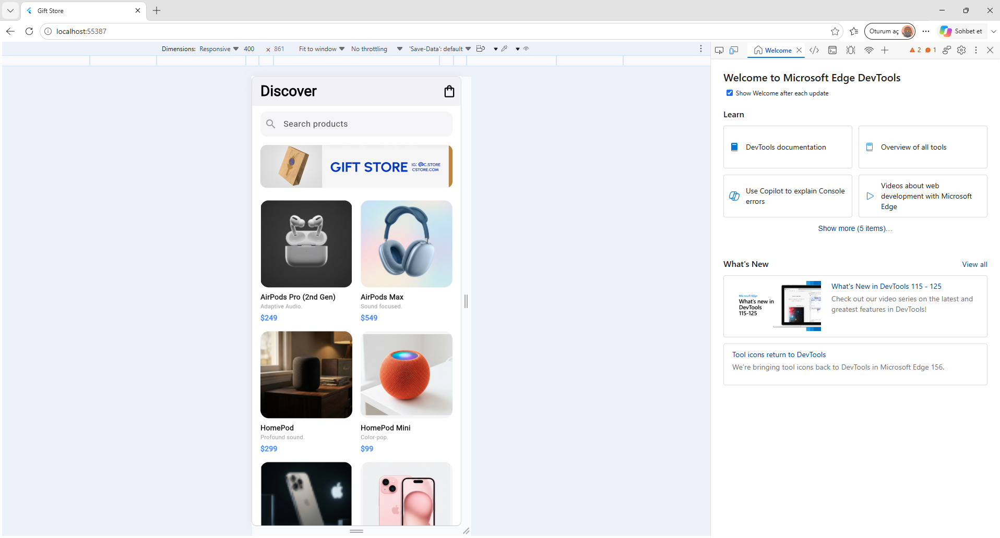
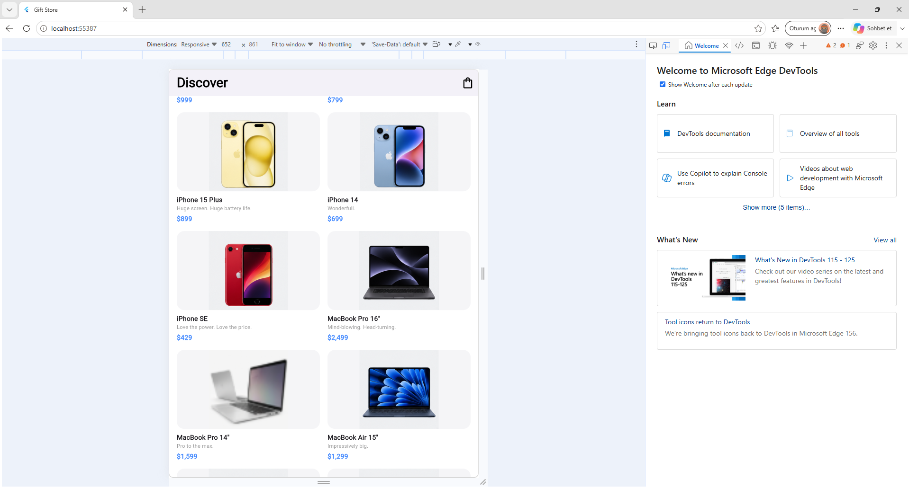
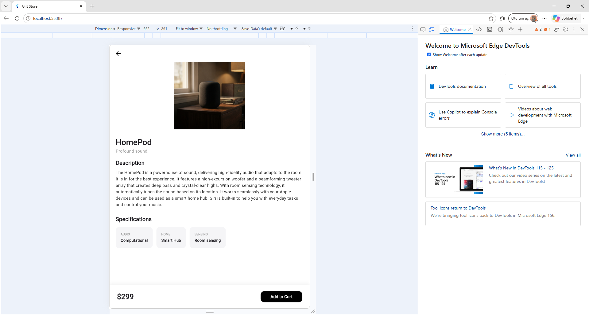
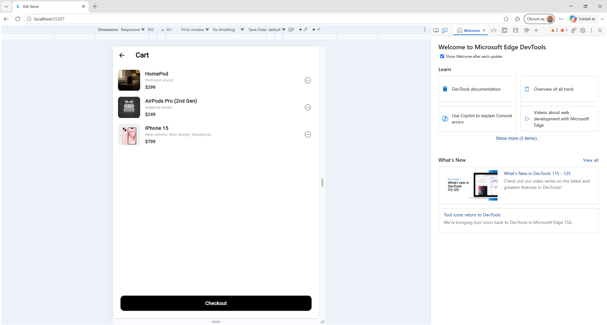
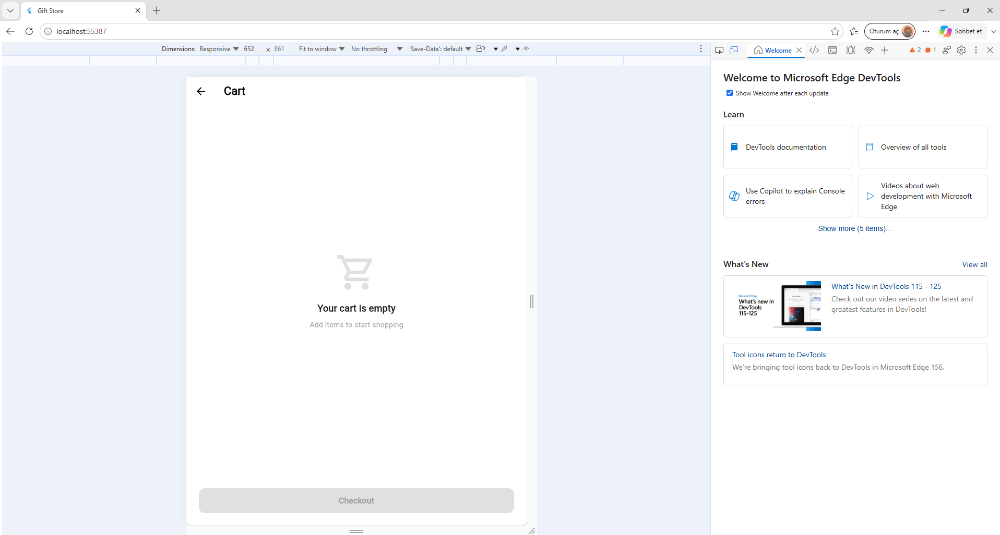

# Mini Katalog Uygulaması

Software Persona Yazılım Mesleki Gelişim Programı kapsamında Flutter ve Dart ile geliştirdiğim ürün kataloğu ve sepet uygulaması.

## Özellikler

- 20 ürünü görselleri ve fiyatlarıyla listeleme
- Ürün adına göre arama
- Ürün açıklamasını ve teknik özelliklerini görüntüleme
- Sepete ürün ekleme ve eksi düğmesiyle bir adet kaldırma
- Checkout ekranında ürün adedini ve toplam tutarı görüntüleme
- Demo siparişini onayladıktan sonra sepeti boşaltma

Checkout demo amaçlıdır. Ödeme alınmaz.

## Kurulum ve Çalıştırma

**SDK sürümleri:** Flutter 3.47.9 ve Dart 3.13.7.

Terminali `pubspec.yaml` dosyasının bulunduğu klasörde açın ve bağımlılıkları yükleyin:

```bash
flutter pub get
```

Chrome’da çalıştırmak için:

```bash
flutter run -d chrome
```

Android’de çalıştırmak için bir emülatör başlatın veya fiziksel cihaz bağlayın. Ardından cihaz kimliğini bulun ve uygulamayı çalıştırın:

```bash
flutter devices
flutter run -d <cihaz_kimligi>
```

## Ekran Görüntüleri

| Ana Sayfa | Ürün Listesi | Ürün Detayı |
| --- | --- | --- |
|  |  |  |

| Dolu Sepet | Boş Sepet |
| --- | --- |
|  |  |

## Veri ve Görseller

Katalog, WANTAPI örnek verisini yerel JSON dosyasından okur. Yedi ürün görseli proje yönergesinden alınmıştır. Kalan 13 ürün için temsili görseller kullanılmıştır.

## Testler

```bash
flutter test
```

**Hazırlayan:** Kağan Uçar